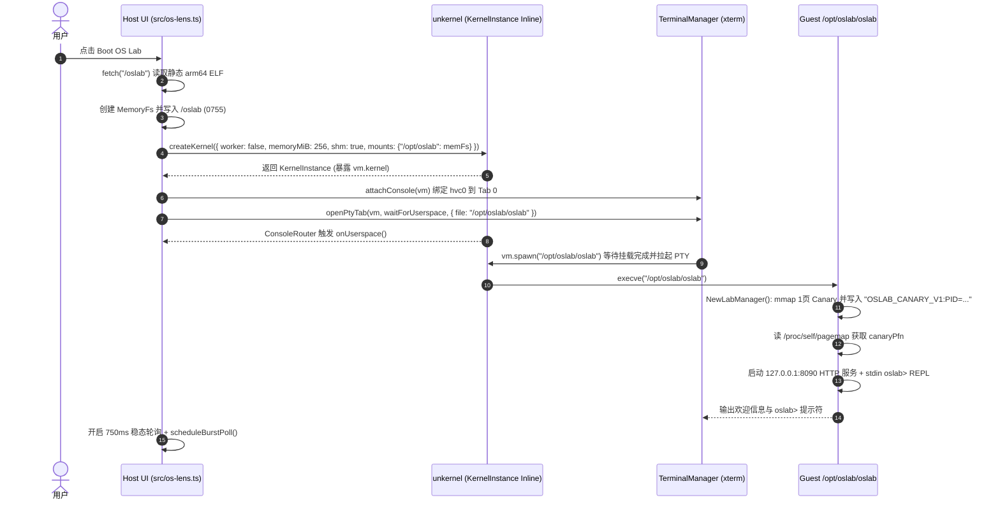
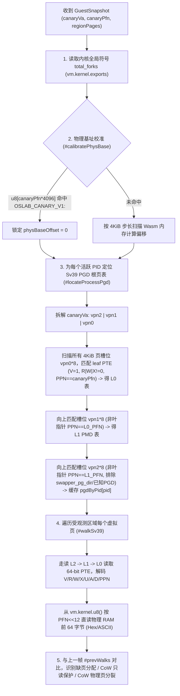

# OS Lab（OS 内核透视镜）完整运行流程梳理

本文档详细梳理 `unkernel-demo` 中 **OS 内核透视镜**（`os-lens.html` + `src/os-lens.ts` + `src/os-lens/*` + `src/guest-oslab/*`）从启动加载、指令执行、内核内存直读自校准到三联动可视化渲染的完整端到端流程。

---

## 1. 整体协同模型

OS Lab 采用 **「Inline 内核宿主机直读 + Guest 原生系统调用实验台」** 的双通道架构：

- **Guest 侧（`/opt/oslab/oslab`）**：静态编译的 `linux/arm64` Go 程序，负责在左屏 PTY 中提供交互式命令行（执行真实的 `SYS_mmap`、`SYS_clone`、`SYS_wait4`、读写虚拟地址触发真实缺页中断），并通过 loopback HTTP (`127.0.0.1:8090/api/snapshot`) 暴露 `/proc` 进程树、VMA（`/proc/<pid>/maps`）与 `/proc/<pid>/pagemap` 视图。
- **Host 侧（`src/os-lens.ts` + `KernelMemoryIntrospector`）**：以 `worker: false` Inline 模式运行 `createKernel`，主线程直接持有 `vm.kernel.memory.buffer` 与内核导出符号 `vm.kernel.exports`，在每次采样时直接走读 Wasm 线性内存中的 **Sv39 三级页表** 与 **4 KiB 物理页帧内容**，驱动右侧三个联动可视化面板。

---

## 2. 阶段一：启动、挂载与初始化流程

### 关键细节说明
1. **Inline 模式必要性**：在 [src/os-lens.ts](../src/os-lens.ts) 中必须传 `worker: false`（`KernelInstance`），这样宿主机主线程才能直接访问 `vm.kernel.memory.buffer`、`vm.kernel.dv()`、`vm.kernel.u8()` 与 `vm.kernel.exports`。
2. **Canary 锚点预埋**：`NewLabManager()`（[src/guest-oslab/mm_lab.go](../src/guest-oslab/mm_lab.go)）启动时立即 `mmap` 一页匿名内存并写入 `"OSLAB_CANARY_V1:PID=<pid>"`，随即读取 `/proc/self/pagemap` 得到其物理页帧号 `canaryPfn`，供宿主机进行零假设偏移自校准。

---

## 3. 阶段二：用户指令执行与双通道采样时序

用户在左屏既可以**直接敲入命令**，也可以点击顶部实验剧本按钮（[src/os-lens/lesson-guide.ts](../src/os-lens/lesson-guide.ts)）：

1. **指令下发**：
   - 点击实验步骤按钮或快捷芯片时，Host 调用 `terminals.sendToActive(cmd + "\r")` 将命令写入当前活跃的 `@xterm/xterm` PTY（与手动键入完全等价）。
   - 同时调用 `scheduleBurstPoll()`，在命令发出后的 `60ms`、`200ms`、`480ms` 触发三次高频突发采样（叠加后台 `750ms` 定时轮询），确保内核状态变化立即反映在右侧面板。
2. **Guest 命令解析与执行（[src/guest-oslab/main.go](../src/guest-oslab/main.go)）**：
   - `normalizeLine()` 同时兼容类 C 调用语法（如 `mmap(1, rw)`、`fork()`、`munmap(r0)`）和空格分隔语法（如 `write r0 0 "hello"`、`child 12 write r0 0 "cow"`）。
   - 若命令以 `!` 开头或不属于 `oslab` 内置命令，则回退到 `/bin/sh -c` 作为常规 Linux 命令执行。
3. **Control Plane 快照收集（`GET /api/snapshot`）**：
   - Host 通过 `vm.fetch("http://127.0.0.1:8090/api/snapshot")`（经 `kwtty` + `vsock` 隧道访问 Guest 回环端口）拉取 `GuestSnapshot`：
     - `parentPid`、`canaryVa`、`canaryPfn`、`canaryByPid`
     - `regions`（`LabManager` 管理的 `mmap` 区域元数据）与 `regionPages`（对每个活跃 PID 调用 `pread64` 读取 `/proc/<pid>/pagemap` 得到 `present` 与 `pfn`）
     - `children`（存活与僵尸子进程状态）、`procTree`（遍历 `/proc/<pid>/{stat,status,cmdline}` 构建）、`mapsByPid`（`/proc/<pid>/maps`）、`vmstat`（`/proc/vmstat` 的 `pgfault`/`pgmajfault`/`nr_anon_pages`/`nr_free_pages`）与 `events` 事件流水。

---

## 4. 阶段三：宿主机 Wasm 内存自校准与 Sv39 页表直读流程

拿到 `GuestSnapshot` 后，`src/os-lens.ts` 调用 `introspector.inspect(vm.kernel, snap)`（[src/os-lens/memory-introspector.ts](../src/os-lens/memory-introspector.ts)），执行四步硬件级内存透视：

### 关键设计亮点
- **零硬编码内核结构体偏移**：不依赖 `task_struct->mm` 或 `mm_struct->pgd` 的编译期字节偏移，通过 Canary 页的 `(VA, PFN)` 反向索引直接锁定真实 Sv39 页表，跨内核构建版本稳健可用。
- **PGD 缓存与生命周期清理**：定位到某 PID 的 `PGD` 地址后缓存在 `#pgdByPid` 中，后续轮询只需 `O(1)` 走读三级 PTE（3 次 `DataView.getBigUint64`），并在子进程退出后自动清理缓存。
- **CoW 与分裂判定逻辑**：
  1. 若 `pfn === null`（PTE `V=0` 且 `pagemap` 未驻留）：判定为 `lazy-unmapped`。
  2. 统计每个 `PFN` 被多少个不同 PID 引用（`pfnPidCount`）：若引用进程数 `> 1` 且 L0 PTE 的 `W=0`（或非 `MAP_SHARED`），判定为 `cow-shared-ro`（写时复制武装状态）。
  3. 对比上一轮 `#prevWalks`：
     - `null -> PFN`：记录 `Demand fault allocated PFN ...`
     - `oldPfn -> newPfn`：记录 `CoW split: PFN old -> new` 并写入 `recentSplits` 列表高亮展示。

---

## 5. 阶段四：三大核心 OS 实验的内核级流转

### 5.1 实验 1：`mmap()` 懒分配与缺页中断（Demand Paging）
1. 用户输入 `mmap(1, rw)`：`mm_lab.go` 调用 `syscall.Mmap(-1, 0, 4096, PROT_READ|PROT_WRITE, MAP_PRIVATE|MAP_ANONYMOUS)`。内核仅在 `mm_struct` 插入 VMA，**不分配物理页帧**。此时右侧 Sv39 视图显示 VMA 存在但 L0 PTE 为 `V=0`。
2. 用户输入 `read r0 0`：`ReadRegion()` 解引用 `r0` 首页地址，CPU 触发读缺页中断（`handle_mm_fault -> do_anonymous_page`）。内核分配零页 `PFN` 并写入 PTE，右侧实时出现 `PGD -> PMD -> PTE -> PFN`，`/proc/vmstat` 的 `pgfault` 递增。
3. 用户输入 `write r0 0 "hello-sv39"`：写入字符串后，宿主机直接从 `vm.kernel.u8()` 读出该 `PFN` 物理内存中的 `"hello-sv39"` 字节并刷新到 CoW 物理帧卡片。

### 5.2 实验 2：`fork()` 与 Copy-on-Write（写时复制）物理页分裂
1. 准备脏页并执行 `fork()`：`LabManager.Fork()` 先创建双向管道 `cmdPipe` / `ackPipe`，随后调用 `runtime.LockOSThread()` 与 `syscall.RawSyscall6(syscall.SYS_CLONE, uintptr(syscall.SIGCHLD), 0, 0, 0, 0, 0)`。
2. **安全子进程循环（`childRawLoop`）**：为规避 Go 运行时 GC/调度器在多核/多线程状态 `fork()` 后的死锁风险，子进程（`pid == 0`）**严格只调用 `syscall.RawSyscall`** 与栈上固定字节数组（`[160]byte` / `[128]byte`），阻塞读取 `cmdPipe` 等待父进程发来的 `'R'`（读）、`'W'`（写）或 `'X'`（退出）指令。
3. **`fork()` 瞬间状态**：Linux `copy_page_range()` 复制父进程页表到子进程的新页表，并将父子双方 L0 PTE 的 `W` 位同时清 `0`。宿主机立即定位出子进程的新 `PGD` 物理页地址，Sv39 视图并排展示父子各自独立的 `PGD -> PMD -> PTE` 但指向**同一个 `PFN`**，CoW 视图显示该 `PFN` 被父子共同引用（`共享只读 ×2`）。
4. **子进程只读 (`child <pid> read r0 0`)**：子进程直接读取该 VA，因 PTE 允许读（`R=1`），不触发写缺页，双方继续共享原 `PFN`。
5. **子进程写入 (`child <pid> write r0 0 "child-cow"`)**：子进程向只读 PTE 写入字节，触发写保护缺页中断（`wp_page_copy`）：内核新分配物理页 `PFN_new`、复制原 4 KiB 数据、将子进程 L0 PTE 更新为 `(PFN_new, W=1, D=1)`。宿主机检测到 `oldPfn -> newPfn` 跳变，右侧立即弹出 `CoW 物理页分裂` 横幅，并展示两个物理页帧各自的实时 RAM 内容（父页保持原内容，子页变为 `"child-cow"`）。

### 5.3 实验 3：子进程退出、Zombie (`Z`) 态与 `wait4()` 回收
1. 用户输入 `child <pid> exit`：父进程通过管道发送 `'X'`，子进程调用 `SYS_exit(0)` 退出。内核释放子进程 `mm_struct` 但保留 `task_struct`。此时 `/proc` 进程树中该子节点状态变为红色 **`Z (Zombie)`**。
2. 用户输入 `wait <pid>`：父进程调用 `syscall.Wait4()` 回收子进程 PCB，该子节点从活跃进程树中移除。

---

## 6. 阶段五：右侧三联动可视化渲染链路

每次 `pollOnce()` 产出 `(snap, report)` 后，同步更新三个视图及事件流：

1. **Sv39 三级页表透视（[src/os-lens/sv39-view.ts](../src/os-lens/sv39-view.ts)）**：
   - 将选中区域的当前页虚拟地址按 Sv39 格式拆解为 `VPN[2]`、`VPN[1]`、`VPN[0]`、`Off`。
   - 有存活子进程时自动切换为双列并排模式（Parent vs Child），PTE 发生状态变化或 PFN 分裂时触发黄色脉冲边框（`.is-changed`）与变更原因提示。
2. **CoW 物理页分裂面板（[src/os-lens/cow-view.ts](../src/os-lens/cow-view.ts)）**：
   - 按 `PFN` 聚合展示物理页帧卡片，列出所有引用该页帧的 `(PID, VA, RW/RO, Dirty)`，并渲染宿主机直读的 RAM ASCII + Hex 预览。
3. **`/proc` 实时进程树（[src/os-lens/proc-tree-view.ts](../src/os-lens/proc-tree-view.ts)）**：
   - 按 `PPID -> PID` 缩进渲染完整 Linux 进程树（标注 `oslab Parent` / `CoW Child`、状态、`VmRSS`、`minFlt/majFlt`）。
   - 点击任意进程行会切换下方 `/proc/<pid>/maps` VMA 列表；若点击的是子进程，还会联动切换 `Sv39View` 右侧的对比子进程。
