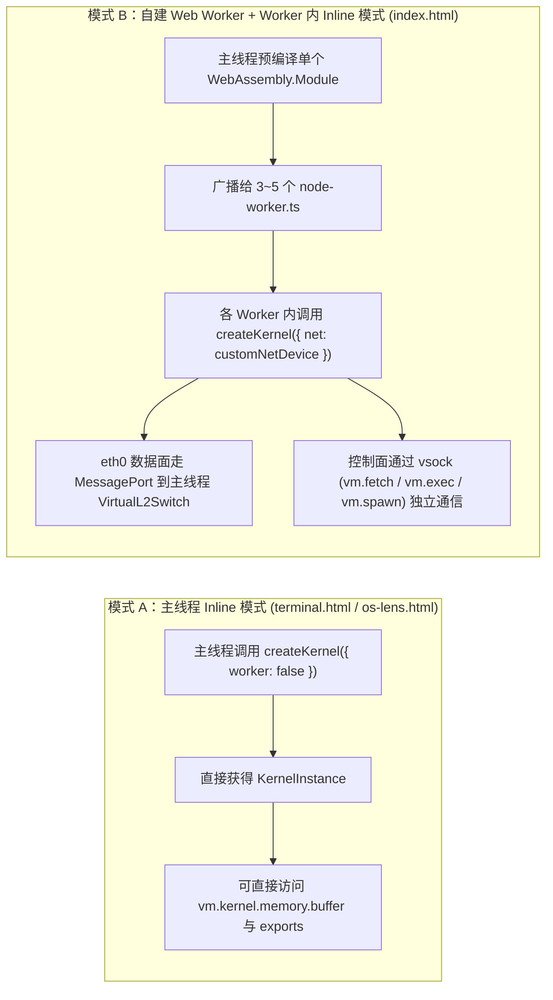

# `unkernel-demo` 项目核心结构与架构梳理

本文档梳理 `unkernel-demo` 仓库的整体定位、目录布局、核心运行模式、三大 Web 应用子系统及 Guest/Host 交互链路，便于后续维护与二次开发。

---

## 1. 项目定位与技术栈

`unkernel-demo` 是基于 `unkernel`（见 [package.json](../package.json)，编译为 WebAssembly 的真实 Linux 7.3.4 内核 + `kwemu` aarch64 用户态模拟器）构建的多页面原型验证平台，核心验证方向包括：

1. **浏览器内多节点真实 Linux Raft 集群与 L2 混沌工程**（`/`）
2. **单节点多标签交互式 Linux 终端与宿主机文件挂载**（`/terminal.html`）
3. **实时内核机制透视镜（交互式 OS 教材：Sv39 页表 / CoW 分裂 / `/proc` 进程树）**（`/os-lens.html`）
4. **Node.js 端最小 SDK 示例**（`src/node-demo.mjs`）

| 层级 | 核心技术 / 组件 | 说明 |
| :--- | :--- | :--- |
| **前端构建** | Vite 6 + TypeScript (`strict: true`) | 多页应用（`vite.config.js` 配置 `index.html`、`terminal.html`、`os-lens.html`），`optimizeDeps.exclude: ["unkernel"]` 以保留 `unkernel.wasm` 相对 URL 解析 |
| **内核运行时** | `unkernel` SDK (`vmlinux32.wasm`) | 依赖浏览器 WebAssembly JSPI（Chrome/Edge 137+、Firefox 153+、Safari 27+），提供 `createKernel`、`ConsoleRouter`、`MemoryFs`、`vm.spawn`、`vm.exec`、`vm.fetch`、`NetDevice`、`Kernel` 内存与导出符号 |
| **终端组件** | `@xterm/xterm` + `@xterm/addon-fit` | 统一由 `src/terminal-manager.js` 封装多标签 `hvc0` 控制台与 `vm.spawn()` PTY 会话 |
| **Guest 二进制** | Go 1.15 (`GOOS=linux GOARCH=arm64 CGO_ENABLED=0`) | 编译为静态 `arm64` ELF 放至 `public/`，运行期通过 `MemoryFs` 挂载进 Linux Guest |

---

## 2. 仓库目录总览

```text
unkernel-demo/
├── index.html                        # 入口 1：Raft Chaos Lab 页面
├── terminal.html                     # 入口 2：单节点多标签 Linux 终端页面
├── os-lens.html                      # 入口 3：OS 内核透视镜分屏教学页面
├── package.json                      # 依赖与构建脚本（dev/build/build:raft/build:oslab/node-demo）
├── vite.config.js                    # Vite 多页入口与 Worker ES 格式配置
├── tsconfig.json                     # TypeScript 编译配置
├── README.md                         # 项目快速开始与功能说明
├── docs/
│   ├── raft-chaos-cluster-design.md  # Raft 混沌工程集群原始设计文档
│   ├── project-architecture.md       # 本文档：项目核心结构梳理
│   └── os-lens-workflow.md           # OS Lab（OS 内核透视镜）完整流程梳理
├── public/                           # 静态构建产物目录（运行时由前端 fetch 加载）
│   ├── raft-node                     # 静态 arm64 Raft 节点二进制（git ignored，npm run build:raft 生成）
│   └── oslab                         # 静态 arm64 OS 实验台二进制（git ignored，npm run build:oslab 生成）
└── src/
    ├── terminal-manager.js           # 公共多标签 @xterm/xterm 管理器（hvc0 + PTY）
    ├── style.css                     # 基础暗色主题与 Terminal 页面样式
    ├── node-demo.mjs                 # Node.js (>=24 JSPI) 最小 SDK 示例
    │
    ├── main.js                       # [Terminal] 页面逻辑（Boot、ConsoleRouter、exec、MemoryFs）
    │
    ├── main.ts                       # [Raft Chaos Lab] 主入口与模块编排
    ├── chaos.css                     # [Raft Chaos Lab] 样式
    ├── cluster/                      # [Raft Chaos Lab] 虚拟交换机与 Worker 集群控制面
    │   ├── types.ts                  # 节点、交换机遥测、混沌规则、Raft 状态、时间线类型定义
    │   ├── dhcp.ts                   # 轻量 L2 DHCP 应答器（MAC -> 10.10.0.1x）
    │   ├── net-device.ts             # Worker 侧 NetDevice <-> Transferable MessagePort 桥接
    │   ├── switch.ts                 # 主线程 VirtualL2Switch（MAC 学习/TCP 嗅探/混沌规则）
    │   ├── node-worker.ts            # 单节点 Web Worker（运行 inline createKernel + RPC）
    │   └── cluster-manager.ts        # 集群生命周期、控制面轮询、KV 压测与 PTY 代理
    ├── ui/                           # [Raft Chaos Lab] 视图组件
    │   ├── topology-view.ts          # 集群 SVG 拓扑与节点状态卡片
    │   ├── chaos-panel.ts            # 链路延迟/抖动/丢包/断网/脑裂/压测面板
    │   ├── telemetry-chart.ts        # Canvas 实时折线图与统一事件时间线
    │   └── terminal-drawer.ts        # 带外 vsock 节点终端抽屉
    ├── guest-raft/                   # [Raft Chaos Lab] Guest Go Raft 服务源码
    │   ├── main.go / raft.go / transport.go / http.go / raft_test.go
    │   └── go.mod / build.ps1 / build.sh
    │
    ├── os-lens.ts                    # [OS 内核透视镜] 页面主控逻辑
    ├── os-lens.css                   # [OS 内核透视镜] 分屏与 Sv39/CoW 可视化样式
    ├── os-lens/                      # [OS 内核透视镜] 宿主机直读与可视化模块
    │   ├── types.ts                  # Guest 快照、Sv39 PTE、CoW 物理页、/proc 进程树类型
    │   ├── memory-introspector.ts    # Canary 标定 + vm.kernel.memory Sv39 三级页表直读引擎
    │   ├── sv39-view.ts              # Sv39 地址拆解与父子进程页表对比视图
    │   ├── cow-view.ts               # CoW 物理页帧分裂与 RAM Hex/ASCII 视图
    │   ├── proc-tree-view.ts         # /proc 实时进程树与 VMA (/proc/<pid>/maps) 面板
    │   └── lesson-guide.ts           # 交互式教材实验步骤控制器
    └── guest-oslab/                  # [OS 内核透视镜] Guest Go OS 实验台源码
        ├── main.go / mm_lab.go / proc.go
        └── go.mod / build.ps1 / build.sh
```

---

## 3. 内核嵌入的两种核心运行模式

`unkernel` 限制**每个线程最多运行一个内核实例**，且底层能力在主线程与 Worker 间有所取舍。本项目针对不同场景采用了两种模式：



| 对比维度 | 模式 A（主线程 Inline） | 模式 B（自建 Worker + Inline） |
| :--- | :--- | :--- |
| **使用页面** | `terminal.html`、`os-lens.html` | `index.html`（Raft Chaos Lab） |
| **实例数量** | 单节点（1 个内核） | 多节点（3~5 个独立内核并行运行） |
| **是否可直读 Wasm 内存** | 是（`vm.kernel.memory.buffer` 与 `exports` 直接暴露） | 在各 Worker 线程内部隔离，主线程通过 RPC/vsock 交互 |
| **网络架构** | 默认无 L2 交换机，仅用 loopback `vm.fetch()` / `vsock` | 自定义 `NetDevice` 将 L2 帧转发至主线程 `VirtualL2Switch` |

---

## 4. 三大 Web 子系统详细架构

### 4.1 Raft Chaos Lab（`index.html` + `src/main.ts`）

按 [raft-chaos-cluster-design.md](docs/raft-chaos-cluster-design.md) 实现**控制面与数据面严格分离**：

1. **数据面（`kwnet` -> `eth0` -> `VirtualL2Switch`）**：
   - `src/cluster/net-device.ts` 将 Guest `eth0` 的每帧数据通过 `Transferable ArrayBuffer` 零拷贝传回主线程 `VirtualL2Switch`（`src/cluster/switch.ts`）。
   - `DhcpResponder`（`src/cluster/dhcp.ts`）应答 Guest 启动时 `udhcpc` 的 DHCP 请求，分配 `10.10.0.11` ~ `10.10.0.15`。
   - `VirtualL2Switch` 维护 MAC 转发表、执行单向/双向 `LinkChaosRule`（延迟、抖动、随机丢包、物理断线、乱序），并旁路解析 IPv4/TCP 头部以统计真实重传、DupACK、SYN/RST 与 RTT。
2. **控制面（`kwvsock` -> `node-worker.ts` -> `ClusterManager`）**：
   - 即使 `eth0` 彻底断线，主线程仍可通过 `vsock` 对各 Worker 发起 `collect_telemetry`（请求 `http://127.0.0.1:8080/_chaos/status` 并读取 `/proc/net/snmp`、`/proc/net/tcp`）、`kill_raft` / `start_raft`、`pty_open`（带外终端抽屉）与 `worker.terminate()`（模拟整机断电）。
3. **Guest 负载（`src/guest-raft/` -> `public/raft-node`）**：
   - 静态编译 Go Raft 节点，监听 `:2380`（TCP 自定义帧协议传递 `RequestVote` / `AppendEntries`）与 `:8080`（`/_chaos/status`、`/kv`、`/kv/all`、`/health`）。

### 4.2 unkernel Terminal（`terminal.html` + `src/main.js`）

单节点全功能 SDK 展示页：
- 通过 `ConsoleRouter` 将内核日志（`dmesg`）与用户态输出分离。
- 通过 `TerminalManager`（`src/terminal-manager.js`）管理 `console (hvc0)` 固定标签与多个 `vm.spawn()` PTY 标签。
- 右侧边栏集成 `vm.exec()` 命令执行器与挂载在 `/mnt/host` 的 `MemoryFs`（监听 `onChange` 事件实时展示 Guest/Host 双向文件变更）。

### 4.3 OS 内核透视镜（`os-lens.html` + `src/os-lens.ts`）

交互式 OS 教学分屏应用，采用「**Guest 交互实验台 + 宿主机 Wasm 内存直读**」双通道协同架构：

1. **Guest 侧（`src/guest-oslab/` -> `public/oslab`）**：
   - 运行在左屏 `@xterm/xterm` PTY 中的交互式 REPL，同时在 `127.0.0.1:8090` 提供 `/api/snapshot`。
   - `mm_lab.go` 调用原生 `arm64` 系统调用：`SYS_mmap`（匿名懒分配，故意不触页以保留 `PTE V=0`）、内存读写触发真实 Minor Fault、`SYS_clone(SIGCHLD, 0)` 创建真实子进程（子进程仅用 `syscall.RawSyscall` 与栈上数组通过管道接收父进程读写/退出指令，确保 Go 下 `fork()` 稳定安全）、`SYS_wait4` 回收僵尸进程。
   - `proc.go` 采集 `/proc/<pid>/{stat,status,cmdline,maps,pagemap}` 与 `/proc/vmstat`。
2. **宿主机观测引擎（`src/os-lens/memory-introspector.ts`）**：
   - **自校准与定位**：启动时利用 `oslab` 的 Canary 页（写入 `OSLAB_CANARY_V1:PID=...` 并查询 `/proc/self/pagemap` 得到的 `PFN`），在 `vm.kernel.memory.buffer` 中验证物理地址到 Wasm 线性内存的偏移，并沿 `L0 -> L1 -> L2` 反向定位父子进程的 Sv39 `PGD` 根页表基址（避免硬编码 `task_struct`/`mm_struct` 偏移）。
   - **实时直读**：直接按 Sv39 三级索引（`VPN[2]` -> `VPN[1]` -> `VPN[0]`）从 `vm.kernel.dv()` 读取 64-bit PTE（解析 `V/R/W/X/U/G/A/D/PPN`）以及物理页帧的真实字节内容，并结合 `/proc/<pid>/pagemap` 识别懒分配、CoW 只读共享（`W=0`）与 CoW 物理页分裂事件。
3. **右侧联动视图（`src/os-lens/`）**：
   - `sv39-view.ts`：虚拟地址位段拆解 + 父子进程三级页表并排对比 + 变更脉冲高亮。
   - `cow-view.ts`：按物理 `PFN` 聚合进程引用关系，展示 CoW 共享与分裂前后的 4 KiB 物理 RAM 字节对比。
   - `proc-tree-view.ts`：实时 `/proc` 进程树（含 `Z` 僵尸态）与选中进程的 VMA 映射表。
   - `lesson-guide.ts`：内置「需求分页」「`fork()` + CoW 分裂」「僵尸进程与 `wait4()`」三套一键分步教学剧本。

---

## 5. 公共基础设施与构建链

- **多标签终端复用（`src/terminal-manager.js`）**：同时服务于 `terminal.html`（单节点终端）、`index.html`（`TerminalDrawer` 通过 `WorkerVmProxy` 跨 Worker 代理 PTY）以及 `os-lens.html`（自动拉起 `/opt/oslab/oslab` PTY 会话），并带有防输出洪峰的分片让出（`SLICE_MS = 16` / `SLICE_BYTES = 262144`）。
- **构建命令（`package.json`）**：
  - `npm run build:raft`：编译 `src/guest-raft` 至 `public/raft-node`
  - `npm run build:oslab`：编译 `src/guest-oslab` 至 `public/oslab`
  - `npm run dev` / `npm run build` / `npm run preview`：Vite 开发、生产构建与预览
  - `npm run node-demo`：运行 `src/node-demo.mjs`（需 Node.js >= 24 JSPI 支持）
