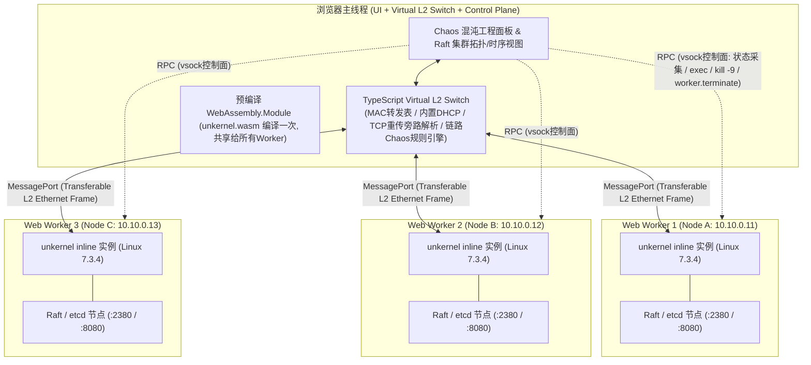

# 浏览器内多节点 Raft 集群与可视化混沌工程（Chaos Engineering）方案设计

本文档基于 `unkernel` SDK（参考源码：`D:/workspace/opensource/unkernel`），给出在**单个浏览器页面内启动 3～5 个独立 Linux 节点组成真实 Raft 集群（如 etcd 或静态编译 Raft 服务）**，并通过 **TypeScript 虚拟 L2 交换机 + 可视化混沌工程面板** 实时注入网络故障与进程故障、观察真实 Linux 内核 TCP 拥塞控制重传及 Raft Leader 重新选举的完整实现方案。

---

## 1. 架构总览

### 1.1 核心设计原则：控制面与数据面分离

在真实数据中心里，业务流量走数据面网卡（`eth0`），而带外管理（BMC/带外监控）走独立控制通道。借助 `unkernel` 的双设备机制，可以在浏览器里完美复现这一架构：

- **数据面（`kwnet` -> `eth0` -> TypeScript 虚拟 L2 交换机）**：
  - 所有 Raft 节点之间的心跳、投票（`RequestVote`）、日志复制（`AppendEntries`）、客户端读写都走各节点真实的 Linux 内核 TCP/IP 协议栈（`eth0`）。
  - 宿主机通过实现 `unkernel` 底层的 **`NetDevice` 接口**，在 L2 原始以太网帧层面将各 Web Worker 节点桥接到一个 TypeScript 虚拟交换机。
  - **所有混沌工程故障（延迟、抖动、丢包、拔网线）全部作用在 L2 交换机转发管线上**，完全保留 Linux 内核真实的 ARP、TCP 三次握手、CUBIC 拥塞控制、Fast Retransmit 与 RTO 指数退避重传。
- **控制面（`kwvsock` -> `vm.exec()` / `vm.fetch()` -> 主线程控制台）**：
  - `vsock` 独立于 `eth0`，**不受虚拟交换机断网/丢包影响**。
  - 即使某个节点的虚拟网线被“瞬间拔掉”（`eth0` 100% 丢包），宿主机主线程依然可以通过 `vm.fetch()` 或 `vm.exec()` 读取该节点 Raft 内部状态（`Role`、`Term`、`CommitIndex`）以及 Linux 内核 `/proc/net/snmp`、`Tcp.RetransSegs`、`/proc/net/tcp` 等指标，或在节点内部执行 `kill -9`。

### 1.2 总体拓扑图



---

## 2. 关键技术选型与 `unkernel` 底层机制对接

### 2.1 为什么采用「自建 Web Worker + 内联 `createKernel()`」而非 `createKernel({ worker: true })`

查阅 `unkernel` 源码（`js/core/instance.ts` 与 `js/core/devices.ts`）可知：
1. `unkernel` 限制 **每个线程只能运行一个内核**（`Only one kernel can run per thread`）。
2. SDK 自带的 `createKernel({ worker: true })` 会把内核放进内部的 `web-worker-entry.ts`，且出于跨线程序列化限制，其 `net` 参数**只接受 `NetSpec`**（`"direct"` 或 `"wisp"`），无法传入自定义的 L2 `NetDevice`。
3. 而如果在应用层自己创建 3～5 个 `new Worker(...)`，在每个 Worker 线程内部直接调用 `createKernel({ net: customNetDevice, ... })`（即该 Worker 线程内的 inline 模式）：
   - 每个 Worker 拥有独立线程与独立 Wasm 内存，互不阻塞；
   - 可直接传入自定义 **`NetDevice`** 截获原始 L2 以太网帧；
   - 可由主线程提前将 `unkernel.wasm` 编译为单个 `WebAssembly.Module` 后通过 `postMessage` 广播给 3～5 个 Worker（`instance.ts` 对 `WebAssembly.Module` 会跳过下载与编译阶段，`compileMs = 0`），极大降低多节点启动耗时与内存峰值。

### 2.2 为什么选择 `kwnet`（`NetDevice` L2 以太网帧）而非 `AF_VSOCK` 桥接

| 对比维度 | `kwnet` (`NetDevice` L2 帧桥接) | `AF_VSOCK` (`VsockOption.raw`) |
| --- | --- | --- |
| 经过 Linux TCP/IP 栈 | **是**（真实经过 `net/ipv4/tcp_*.c`） | 否（虚拟流式 socket，无 IP/TCP） |
| 观察 TCP 拥塞控制与重传 | **支持**（真实 CUBIC cwnd 收缩、Fast Retransmit、RTO 退避） | 不支持（仅有 credit 流控） |
| 兼容现成 Raft/etcd 程序 | **原生兼容**（标准 TCP/HTTP/gRPC 地址如 `10.10.0.11:2380`） | 需魔改软件支持 `AF_VSOCK` 地址族 |
| 与控制面隔离 | **天然隔离**（`kwnet` 跑数据面，`kwvsock` 保留给宿主机控制面） | 混用同一通道，断网测试会误伤宿主管理接口 |

因此，**Raft 节点间通信必须采用 `NetDevice`（L2 原始以太网帧）方案**。

### 2.3 `NetDevice` 与 `Kernel.receiveFrame()` 的底层契约

根据 `unkernel/js/core/kernel.ts`（L105-L113、L470-L474、L691-L710）：
- **`NetDevice` 接口**：
  ```ts
  export interface NetDevice {
    mac?: Uint8Array;              // 6 字节 MAC 地址，写入 guest eth0
    attach?(kernel: Kernel): void; // kwnet 驱动初始化时回调，拿到 Kernel 引用
    send(frame: Uint8Array): void; // guest eth0 发出的每一帧（已是独立的 slice 拷贝）
    close?(): void;                // 内核退出时释放资源
  }
  ```
- **零拷贝跨 Worker 传输安全性**：
  在 `kernel.ts` 的 `wasm_driver_net_send` 实现中，SDK 已经执行了 `k.u8().slice(p, p + Number(len))` 将帧数据从 Wasm 线性内存拷贝到了独立的 `Uint8Array`。因此 Worker 内可直接用：
  ```ts
  switchPort.postMessage({ type: "frame", frame }, [frame.buffer]);
  ```
  以 **Transferable `ArrayBuffer` 零拷贝**方式将以太网帧移交到虚拟交换机，绝不会 detach Wasm 线性内存。
- **帧注入内核**：
  虚拟交换机通过 `MessagePort` 将目的帧发回目标 Worker 后，Worker 调用：
  ```ts
  kernel.receiveFrame(new Uint8Array(buf));
  ```
  该函数会将帧压入 `kernel.netRx` 队列、置位 `IRQ_NET` 并唤醒内核线程。

### 2.4 节点内存规划

浏览器单 Tab 对 Wasm 虚拟地址空间有限制，而 `js/web/memory.ts` 中 `autoMemoryMiB()` 在桌面端默认申请 `2048 MiB`。当同页启动 3～5 个节点时，必须显式限制单节点内存：
- **推荐配置**：`memoryMiB: 256`（运行静态 Go Raft 二进制绰绰有余）或 `memoryMiB: 384`（运行精简版 `etcd`），并配置 `memoryFallbackMiB: [256, 192, 128]`。
- 5 个节点 × 256 MiB = 1.28 GiB 虚拟地址空间预留（按需触页，实际物理内存占用约 150～300 MiB）。

---

## 3. 节点网络初始化与 Raft 负载方案

### 3.1 节点自动配网（内置轻量 DHCP）

`unkernel` 基础镜像在启动时会执行 `/usr/lib/kw/net`：
```sh
ip link set lo up
ip link set eth0 up
udhcpc -i eth0 -s /usr/lib/kw/udhcpc -q -n -t 3 -T 1
```
为了做到**零修改内核与 initramfs**，虚拟交换机内置一个极简 **DHCP Responder**（逻辑与 `js/core/net.ts` 中的 `NetStack.dhcp()` 一致）：
1. 为每个节点分配固定 MAC 与 IP 映射：
   - Node 1: `52:54:00:00:00:01` -> `10.10.0.11/24`
   - Node 2: `52:54:00:00:00:02` -> `10.10.0.12/24`
   - Node 3: `52:54:00:00:00:03` -> `10.10.0.13/24`
   - （可扩展至 Node 4 `10.10.0.14`、Node 5 `10.10.0.15`）
2. 当交换机收到端口发来的 UDP 目的端口 `67` 的 DHCP DISCOVER / REQUEST 广播帧时，不向其他节点泛洪，而是直接构造单播/广播 DHCP OFFER / ACK 帧回复给源端口；`udhcpc` 自动完成 `eth0` IP 与子网掩码配置。
3. 节点之间的 ARP 解析（`who has 10.10.0.12?`）通过交换机的 L2 广播泛洪，由 **Node 2 的真实 Linux 内核** 自己回复 ARP Reply。

### 3.2 Raft 节点程序选型（两种落地路径）

1. **方案 A（推荐：极速启动，零外部镜像依赖）—— 静态编译 `aarch64` Raft 二进制 + `MemoryFs` 挂载**
   - 用 Go（`GOARCH=arm64 CGO_ENABLED=0`）基于 `go.etcd.io/etcd/raft/v3` 或 `hashicorp/raft` 编译一个约 8～12 MB 的单文件 `raft-node` 二进制（包含 Raft 状态机、HTTP KV API、以及 `/_chaos/status` JSON 状态端点）。
   - 每个 Worker 启动 `unkernel` 的内置 base shell（无需下载 Alpine/Debian 镜像，单节点 <1 秒启动），通过 `MemoryFs` 将 `raft-node`（`mode: 0o755`）挂载到 `/opt/raft/raft-node`，随后由宿主机通过 `vm.exec()` 拉起。
2. **方案 B（真实生产软件：`etcd`）—— `alpine.erofs` + `etcd` 包**
   - 若希望直接运行原生 `etcd` 集群，可加载托管在本地/同源的 `alpine.erofs`，在镜像中预打包 `etcd` 与 `iproute2`（`ss`），各节点以 `--initial-cluster` 参数启动 `etcd`。
   - 数据目录可放在内存 tmpfs 或每节点独立的 `IdbStore` 虚拟块设备。

---

## 4. TypeScript 虚拟 L2 交换机与混沌引擎设计

虚拟交换机运行在主线程（或单独的 Switch Worker，若需把图表渲染与包转发解耦；推荐**主线程直连各 Node Worker 的 `MessagePort`**，配合低频节流推送指标，开发调试最直观，且无额外跨线程跳数）。

### 4.1 核心数据结构

```ts
export type NodeId = string; // e.g. "node-1", "node-2", "node-3"

export interface LinkChaosRule {
  delayMs: number;      // 单向基础延迟 (0 ~ 2000 ms)
  jitterMs: number;     // 抖动幅度 (± ms)
  dropRate: number;     // 随机丢包率 (0 ~ 1)
  severed: boolean;     // 物理断线（拔网线）：true 时丢弃全部出入帧
  /** 可选：允许抖动乱序，默认 false 时通过单调时间戳保证同链路不乱序 */
  allowReorder?: boolean;
}

export interface SwitchPort {
  nodeId: NodeId;
  macHex: string;       // "52:54:00:00:00:01"
  ip: string;           // "10.10.0.11"
  port: MessagePort;    // 连接对应 Node Worker 的端口
  linkUp: boolean;      // 端口级拔网线开关
  rxFrames: number;
  txFrames: number;
  droppedFrames: number;
}
```

### 4.2 虚拟交换机转发与混沌注入管线

当交换机从 `srcPort` 收到一帧 `frame: Uint8Array` 时，执行以下步骤：

1. **端口隔离检查（拔网线判定）**：
   - 若 `srcPort.linkUp === false`，直接丢弃（`srcPort.droppedFrames++`）并返回，不参与任何学习或转发。
2. **DHCP 拦截（Bootstrap 配网）**：
   - 若帧为 IPv4 UDP 目的端口 `67`，交给内置 `DhcpResponder` 生成 OFFER/ACK，**直接注入 `srcPort`**（不受网络混沌影响，或可单独开关）。
3. **MAC 地址学习与目的端口解析**：
   - 记录 `macTable.set(srcMacHex, srcPort.nodeId)`。
   - 提取目的 MAC（`frame[0..5]`）：
     - 若为广播/组播（`frame[0] & 0x01`），目标列表为除 `srcPort` 外的所有 `linkUp === true` 的端口；
     - 否则查 `macTable.get(dstMacHex)`；若未知则泛洪给其他在线端口。
4. **TCP 帧旁路嗅探（Packet Sniffer，只读不改包）**：
   - 解析 `EtherType === 0x0800`（IPv4）且 `Protocol === 6`（TCP）：
     - 提取 `srcIP:sport -> dstIP:dport`、`seq`、`ack`、`flags (SYN/ACK/FIN/RST/PSH)`、`win`、`payloadLen`。
     - 追踪每条四元组流的最大已发送序号 `maxSeqEnd`：
       - **重传判定**：若 `payloadLen > 0 && seqLt(seq, stream.maxSeqEnd)`，记为一次 **TCP 重传（Retransmit）**！
       - **重复 ACK 判定**：若为纯 ACK 且 `ack === stream.lastAck`，计数 `dupAck++`，达 3 次记为 **Fast Retransmit 触发信号**。
       - **RTT 采样**：记录发出分段 `(seq + payloadLen) -> sendTime`，收到对端 `ack >= expected` 时计算真实往返耗时。
     - 将统计增量通过节流器（如每 100ms 批量一次）推给前端混沌面板图表。
5. **逐目标链路的混沌规则执行（Chaos Pipeline）**：
   对每一个目标端口 `dstPort`：
   - 合并规则：同时检查 `srcPort.linkUp`、`dstPort.linkUp` 及链路规则 `rules.get(`${srcPort.nodeId}->${dstPort.nodeId}`)`。
   - **断连判定**：若 `!dstPort.linkUp || rule.severed`，计入丢包并跳过。
   - **随机丢包判定**：若 `rule.dropRate > 0 && Math.random() < rule.dropRate`，计入丢包并跳过。
   - **延迟与保序投递**：
     - 若 `rule.delayMs === 0 && rule.jitterMs === 0`，立即 `dstPort.port.postMessage(outFrame, [outFrame.buffer])`（多播时需 `.slice()` 复制给每个目标）。
     - 否则计算 `targetTime = now + rule.delayMs + (Math.random() * 2 - 1) * rule.jitterMs`；
     - 若 `!rule.allowReorder`，维护该单向链路的 `lastScheduledAt`，取 `deliverAt = Math.max(lastScheduledAt, targetTime)`，再通过定时器/轻量时间轮队列投递到 `dstPort.port`。

---

## 5. 可视化混沌工程（Chaos Engineering）面板设计

前端面板聚焦“**注入故障 -> 观测内核 TCP 层 -> 观测 Raft 共识层**”的闭环体验。

### 5.1 控制面交互控件（Sliders & Switches）

1. **定向链路注入器（Link Chaos Matrix）**
   - 链路选择器：`源节点` -> `目标节点`（支持勾选“双向同步”，如 `Node A <-> Node B`）。
   - **单向/双向延迟滑块**：`0 ms ～ 2000 ms`（带快捷预设按钮：`正常 0ms` / `跨城 50ms` / `跨洲 300ms` / `触发选主超时 1200ms`）。
   - **网络抖动滑块**：`0 ms ～ 300 ms`。
   - **随机丢包率滑块**：`0% ～ 100%`（带预设：`0%` / `5%` / `20%` / `50%`）。
   - **一键脑裂（Split-Brain）快捷按钮**：如将 `{Node A}` 与 `{Node B, Node C}` 之间的双向规则设为 `severed = true`，验证 Raft 在少数派分区拒绝写入、多数派分区保持可用的特性。

2. **节点生命周期与物理故障开关（每节点卡片独立控制）**
   - **拔网线 / 插网线开关（Link Sever）**：切换虚拟交换机端口 `linkUp`，瞬间切断该节点全部 L2 流量（不发 `FIN`/`RST`）。
   - **强制杀死进程（`SIGKILL` Raft 进程）**：通过 `vsock` 调用 `vm.exec("kill", ["-9", raftPid])`。
     - *观测重点*：Linux 内核依然存活，内核会自动向其余节点发送 **TCP `RST` / `FIN`**，集群几乎在几毫秒内立刻感知对端不可达并触发选主（比拔网线快得多）。
   - **节点硬断电（Terminate Worker）**：调用 `worker.terminate()` 直接销毁 Web Worker 线程。
     - *观测重点*：Linux 内核瞬间蒸发、无任何 TCP 挥手包；其余节点进入真实 **TCP 重传退避（RTO 1s -> 2s -> 4s）+ Raft Election Timeout** 流程。
   - **重启进程 / 重启节点**：重新拉起 `raft-node` 或重建 Worker，观察旧 Leader 作为 Follower 重新加入并追赶日志（Log Catch-up / Snapshot Sync）。

### 5.2 实时可观测视图

1. **集群拓扑与状态机视图（Topology Graph）**
   - 实时渲染 3～5 个节点圆环与连线状态：
     - 节点颜色区分角色：`Leader`（绿色脉冲）、`Candidate`（琥珀色）、`Follower`（蓝色）、`Partitioned / Dead`（灰色/红色）。
     - 节点徽章展示：`Term`、`CommitIndex`、`AppliedIndex`、当前 `eth0` IP。
     - 连线粗细/颜色/标签实时显示当前注入的延迟与丢包率，并在检测到 TCP 重传时在对应连线上闪烁红色脉冲。
2. **Linux 内核 TCP 遥测图表（Kernel TCP Telemetry）**
   - **双源采集**：
     - 交换机侧高频采集（100ms 粒度）：各链路实时 `PPS`、`RTT (ms)`、检测到的 `TCP Retransmits/s`、`DupACKs/s`。
     - 内核侧定时采集（500ms 粒度，通过 `vm.exec` 读取 `/proc/net/snmp` 与 `/proc/net/tcp`）：直接展示 Linux 内核全局 `Tcp: RetransSegs` 累计曲线及连接状态分布（`ESTABLISHED` / `SYN_SENT` / `TIME_WAIT`）。
3. **Raft 写入压测与事件时间线（Workload & Event Timeline）**
   - 内置轻量压测器：宿主机每 200ms 通过 `vm.fetch` 或指定客户端向当前 Leader 发起 `PUT /kv?key=k&val=n`，记录每次写入的成功/失败/耗时。
   - 统一时间线（精确到毫秒）串联底层与上层事件，例如：
     - `00:12.100 [Chaos] Node A -> Node B 注入 20% 丢包 + 300ms 延迟`
     - `00:12.420 [TCP] 10.10.0.11 -> 10.10.0.12 检测到 TCP Retransmit (seq=48219)`
     - `00:13.850 [Raft] Node B Heartbeat 超时，Term 3 -> 4，发起 RequestVote`
     - `00:13.910 [Raft] Node C 投票给 Node B，Node B 成为 Term 4 新 Leader`
4. **单节点交互式终端抽屉（复用现有 `@xterm/xterm` 能力）**
   - 点击任意节点卡片，即可展开该节点的 `@xterm/xterm` 终端窗口，直接在节点内部运行 `cat /proc/net/snmp`、`ip addr`、`ps` 或观察 Raft 原始 stdout 日志。

---

## 6. 建议的模块划分与代码结构

在当前项目的基础上，可按如下结构扩展（与现有 [src/terminal-manager.js](file:///D:/workspace/demo/unkernel-demo/src/terminal-manager.js) 无缝兼容）：

```text
src/
├── cluster/
│   ├── types.ts             # 节点配置、LinkChaosRule、Telemetry 事件类型
│   ├── switch.ts            # VirtualL2Switch（MAC 学习、转发、DHCP、TCP 重传嗅探、Chaos 引擎）
│   ├── dhcp.ts              # 极简 L2 DHCP Responder（分配 10.10.0.11+）
│   ├── net-device.ts        # Worker 侧实现的 unkernel NetDevice（对接 MessagePort 与 kernel.receiveFrame）
│   ├── node-worker.ts       # Web Worker 入口：接收 WebAssembly.Module 并启动 inline createKernel()
│   └── cluster-manager.ts   # 主线程编排器：管理 3~5 个 Worker、控制面 RPC、状态采集与故障注入
├── ui/
│   ├── chaos-panel.ts       # 混沌工程滑块/开关、脑裂预设、杀死进程/断电控制
│   ├── topology-view.ts     # 集群节点/链路实时拓扑与动画
│   └── telemetry-chart.ts   # TCP RetransSegs / RTT / Raft Term 实时曲线与事件时间线
└── guest-raft/              # 静态编译 aarch64 Raft 服务源码（或构建脚本）
```

### 6.1 核心代码片段示例：Worker 侧 `NetDevice` 实现

```ts
// src/cluster/net-device.ts
import type { Kernel, NetDevice } from "unkernel";

export function createWorkerBridgeNetDevice(mac: Uint8Array, switchPort: MessagePort): NetDevice {
  let attachedKernel: Kernel | null = null;

  switchPort.onmessage = (ev: MessageEvent<ArrayBuffer>) => {
    if (!attachedKernel) return;
    attachedKernel.receiveFrame(new Uint8Array(ev.data));
  };

  return {
    mac,
    attach(kernel: Kernel) {
      attachedKernel = kernel;
    },
    send(frame: Uint8Array) {
      // unkernel 已在 wasm_driver_net_send 中执行 slice()，可安全转移 buffer
      switchPort.postMessage(frame.buffer, [frame.buffer]);
    },
    close() {
      attachedKernel = null;
      switchPort.close();
    },
  };
}
```

### 6.2 核心代码片段示例：Worker 启动与共享内核编译

```ts
// 主线程：只编译一次 unkernel.wasm
const kernelModule = await loadKernelModule(bundledKernelUrl, { what: "kernel" });

// 为节点创建与虚拟交换机对接的 MessageChannel
const { port1: switchPort, port2: workerPort } = new MessageChannel();
virtualSwitch.attachPort({ nodeId: "node-1", mac: macBytes, ip: "10.10.0.11", port: switchPort });

const worker = new Worker(new URL("./node-worker.ts", import.meta.url), { type: "module" });
worker.postMessage({ type: "boot", nodeId: "node-1", mac: macBytes, kernelModule, netPort: workerPort }, [workerPort]);
```

---

## 7. 典型混沌实验剧本（可直接作为内置 Demo 场景）

| 实验剧本 | 操作步骤 | 预期观测现象 |
| --- | --- | --- |
| **1. 高延迟触发 TCP 窗口抖动与假超时** | 将 `Leader -> Follower 1` 单向延迟拉到 `300ms`（高于部分心跳间隔，低于 Election Timeout） | 交换机测得 RTT 跃升至 300ms+；若延迟进一步超过 `ElectionTimeout`，Follower 发起新一轮投票，观察预投票（PreVote）或 Term 递增 |
| **2. 20% 丢包观察真实 TCP 重传** | 将 `Leader <-> Node B` 丢包率设为 `20%` | 交换机嗅探器立即捕获 `TCP Retransmit` 与 `DupACK`；Node A 内核 `/proc/net/snmp` 中 `Tcp.RetransSegs` 持续上涨；Raft 写入 P99 延迟剧增但集群仍可提交（A+C 仍占多数） |
| **3. 拔网线制造少数派脑裂** | 断开 `Leader (Node A)` 网线（`linkUp = false`） | Node A 自身写入阻塞/超时；Node B 与 Node C 在 Election Timeout 后快速选出新 Leader 恢复写入；插回网线后 Node A 收到更高 Term 的 AppendEntries 自动退位为 Follower |
| **4. `SIGKILL` 进程 vs `worker.terminate()` 断电** | 先对 Leader 执行“强制杀死进程”，恢复后再执行“断电销毁 Worker” | `kill -9` 时内核发出 TCP `RST`，其余节点毫秒级感知断连；`worker.terminate()` 无任何 `RST`/`FIN`，对端等待心跳超时并经历完整 TCP RTO 重传 |

---

## 8. 性能与浏览器限制注意事项

1. **JSPI 与多 Worker 内存上限**：
   - 浏览器需支持 WebAssembly JSPI（Chrome / Edge 137+、Firefox 153+、Safari 27+）。
   - 多节点场景建议**单节点 `memoryMiB: 256`（最多 512）**，3～5 个节点总计不超过浏览器单进程地址空间预算。
2. **后台标签页定时器节流**：
   - 浏览器会将隐藏标签页的 `setTimeout` 节流到 >= 1000ms，从而扭曲虚拟交换机 50ms/300ms 延迟注入精度。测试混沌实验时应保持页面在前台激活状态，或将虚拟交换机的定时队列放到 **Dedicated Switch Worker** 中并用高频率消息驱动。
3. **Raft 超时参数调优**：
   - Wasm 解释器 + JIT 在浏览器中执行略慢于原生 CPU（约 2～5 倍差距），建议将集群默认 `HeartbeatInterval` 设为 `150ms～200ms`、`ElectionTimeout` 设为 `1000ms～1500ms`，避免在 3～5 节点并发启动或 GC 时发生误选主。
